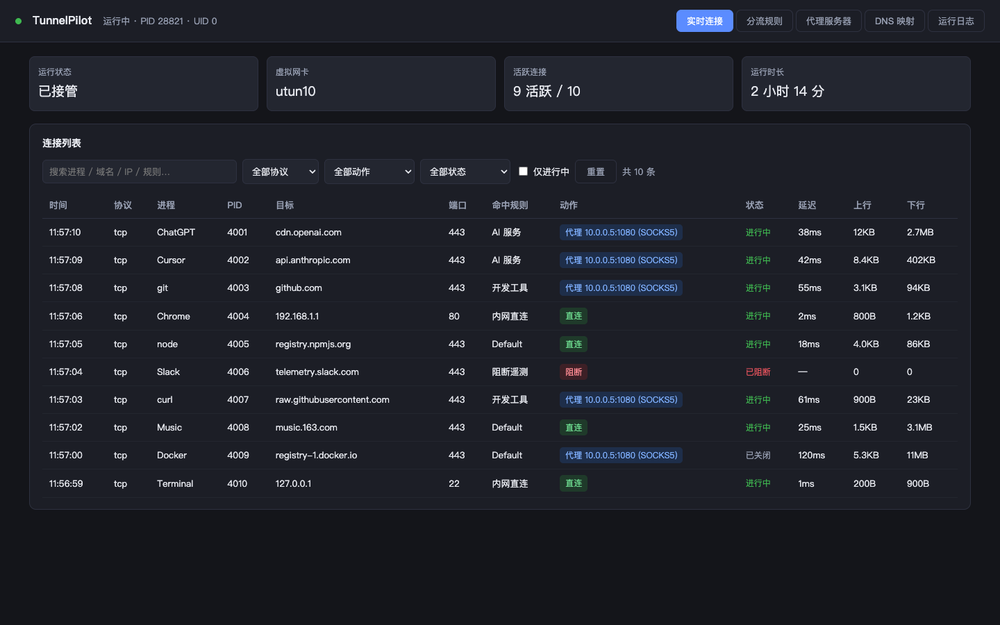
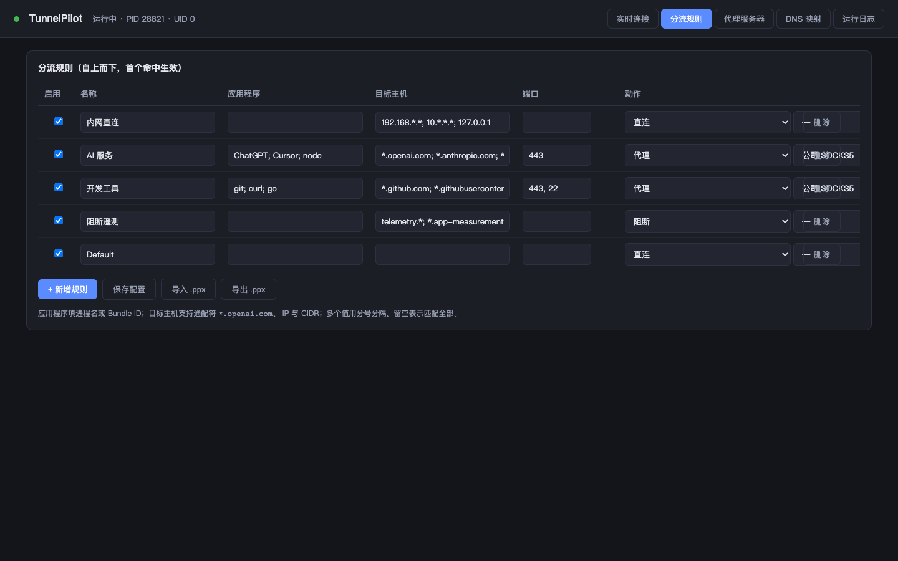

<div align="center">
  
  <h1>TunnelPilot</h1>
  <p>Per-process transparent proxy for macOS</p>
  <p>
    <a href="README.md">中文</a> · <b>English</b>
  </p>
</div>

TunnelPilot takes over all system traffic and routes each connection — based on process, domain and port — to direct, a proxy, a proxy chain, or a block. No per-app proxy configuration required. Written in pure Go; no Xcode, no Apple Developer account.



## Features

- **Transparent interception** — utun virtual interface plus a userspace TCP/IP stack, covering all TCP/UDP traffic
- **Per-process routing** — resolves the owning process of each connection via `libproc` (name / path / bundle ID)
- **Per-domain routing** — Fake-IP DNS hijacking; hostnames are resolved by the upstream proxy, avoiding local DNS pollution
- **Proxy protocols** — SOCKS5 (with auth), SOCKS4a, HTTPS CONNECT
- **Proxy chains** — multi-hop, failover, and round-robin load balancing
- **UDP forwarding** — SOCKS5 UDP ASSOCIATE, covering QUIC and DNS over UDP
- **Config compatibility** — import/export `.ppx` profiles
- **Live monitoring** — connection list filterable by process, action and status
- **Menu bar control** — start/stop in one click, icon reflects the current state

## Menu bar states

| Active | Inactive | Switching |
|:---:|:---:|:---:|
|  |  |  |

## Requirements

- macOS 13 Ventura or later (verified on macOS 15)
- `sudo` for install and runtime (creating utun requires root)
- Go 1.24+ only for building from source

## Installation

### Option 1: Prebuilt release (recommended)

Download `TunnelPilot-*.zip` from the Releases page, then:

```bash
cd TunnelPilot-1.0.0
xattr -dr com.apple.quarantine .   # clear Gatekeeper quarantine
sudo ./tunnelpilot install
```

### Option 2: Build from source

```bash
git clone https://github.com/feng2147685/tunnelpilot.git
cd tunnelpilot
./build.sh
sudo ./tunnelpilot install
```

The installer creates:

| Item | Location |
|---|---|
| Binary | `/usr/local/bin/tunnelpilot` |
| Launch daemon | `/Library/LaunchDaemons/com.tunnelpilot.daemon.plist` |
| Config | `/Library/Application Support/TunnelPilot/config.json` |
| Log | `/var/log/tunnelpilot.log` |
| Menu bar app | `/Applications/TunnelPilot.app` |

## Usage

Open the console at <http://127.0.0.1:9090>.

Add your proxy under **Proxy Servers**, then configure **Rules**. Rules are evaluated top-down and the **first match wins**:



| Rule | Applications | Targets | Ports | Action |
|---|---|---|---|---|
| LAN direct | — | `192.168.*.*; 10.*.*.*; 127.0.0.1` | — | Direct |
| AI services | `ChatGPT; Cursor; node` | `*.openai.com; *.anthropic.com` | 443 | Proxy |
| Dev tools | `git; curl; go` | `*.github.com; *.githubusercontent.com` | 443, 22 | Proxy |
| Block telemetry | — | `telemetry.*; *.app-measurement.com` | — | Block |
| Default | — | — | — | Direct |

- Applications accept process name, executable path, or bundle ID. Empty matches all.
- Targets accept wildcards `*.example.com`, IPs, and CIDR `10.0.0.0/8`.
- Ports accept a single value or a range `8000-8100`.
- Rule changes apply immediately; changing a proxy address requires a service restart.

## CLI

```bash
sudo tunnelpilot              # run in foreground for debugging (Ctrl+C restores routes)
tunnelpilot status            # check default route and gateway health
sudo tunnelpilot restore      # repair routes left behind by an abnormal exit
sudo tunnelpilot uninstall    # remove the service and menu bar app
```

## Troubleshooting

If the process was killed (rather than stopped with Ctrl+C) and networking broke:

```bash
tunnelpilot status            # check whether the default route points at utun
sudo tunnelpilot restore      # clear leftover routes, restore the default gateway
```

If that does not help, toggle Wi-Fi off and on, or reboot.

## How it works

```
App traffic
   ↓
utun virtual interface (kernel routing)
   ↓
gVisor userspace network stack (reassembles TCP/UDP flows)
   ↓
libproc process lookup + Fake-IP hostname recovery
   ↓
Rule matching (process / domain / IP / port)
   ↓
Direct ─ Single proxy ─ Proxy chain ─ Block
```

Outbound sockets are bound to the physical interface (`IP_BOUND_IF`) so they are not routed back into the tunnel; loopback destinations (local proxies) are exempt.

## Limitations

- UDP proxying supports SOCKS5 only; falls back to direct for HTTPS / SOCKS4 proxies
- Process lookup relies on reverse port matching, so very short-lived connections may not resolve
- Changing a proxy address requires a service restart
- IPv6 routing rules are not implemented

## Disclaimer

This software takes over all system network traffic and requires root privileges. Use it only if you understand what it does. You accept all risks, including but not limited to network outages, traffic leaks, and connectivity problems caused by misconfigured rules. The author is not liable for any direct or indirect damages.

You are responsible for complying with the laws of your jurisdiction.

## License

[GPL-3.0](LICENSE). This project links against [sing-tun](https://github.com/SagerNet/sing-tun) and [sing](https://github.com/SagerNet/sing), both GPL-3.0, so the whole project is licensed under GPL-3.0.

## Credits

- [sing-tun](https://github.com/SagerNet/sing-tun) — utun abstraction and Darwin implementation
- [gVisor](https://gvisor.dev/) — userspace TCP/IP stack
- [miekg/dns](https://github.com/miekg/dns) — DNS message handling
